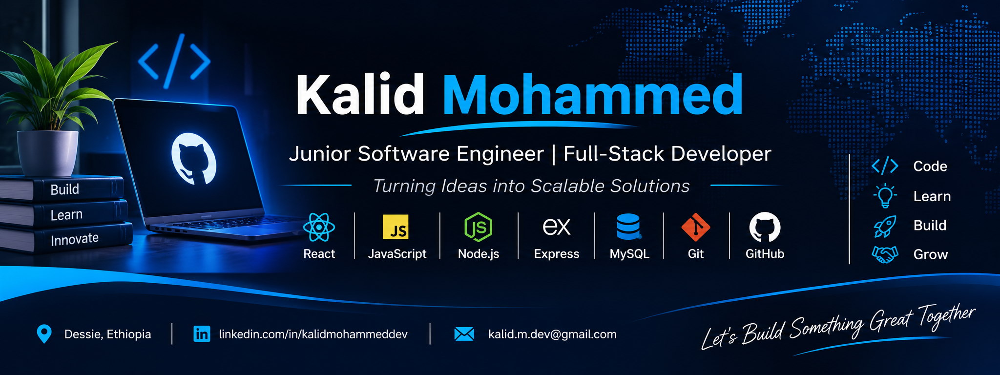

  

 

<!-- Animated Introduction -->

# 👋 Hi, I'm Kalid Mohammed

### 💻 Junior Software Engineer | Full-Stack Developer

**Building practical applications. Solving real-world problems. Learning every day.**

---

## 🚀 About Me

I'm a Software Engineering student passionate about building useful, scalable, and user-friendly applications.

- 💻 Interested in Full-Stack Software Development.
- 🌱 Continuously improving my software engineering skills.
- 🔍 Enjoy solving real-world problems through technology.
- ☁️ Exploring Cloud Computing and Microsoft Azure.
- 🤖 Interested in Artificial Intelligence and AI-powered applications.

---
## 🛠️ Tech Stack & Tools

<table align="center">
<tr>
<td align="center" width="50%">

### 🎨 Frontend

</td>
<td align="center" width="50%">

### ⚙️ Backend

</td>
</tr>

<tr>
<td align="center" width="50%">

### 🗄️ Database

</td>
<td align="center" width="50%">

### 🔧 Tools

</td>
</tr>

<tr>
<td align="center" colspan="2">

### ☁️ Cloud & Infrastructure

</td>
</tr>
</table>

---

## 💼 Featured Projects

### 🎓 Wollo Exam Prep
An online examination preparation platform designed to help university students prepare for exams.

### 📚 WolloShare
A university resource-sharing platform that helps students share and access academic materials.

### 🌐 Personal Portfolio
A personal website showcasing my software development skills, projects, and professional profile.

---

## 📚 Currently Learning

- Advanced JavaScript
- Full-Stack Development
- Software Engineering Best Practices
- Microsoft Azure (AZ-104 learning)
- Artificial Intelligence

---

## 📊 GitHub Statistics

<table>
<tr>
<td>

</td>
<td>

</td>
</tr>
</table>

 

---

## 🤝 Let's Connect

I'm interested in connecting with developers, learning from experienced engineers, and collaborating on meaningful software projects.

- 📧 Email: kalid.m.dev@gmail.com
- 💼 LinkedIn: [Kalid Mohammed](https://www.linkedin.com/in/kalidmohammeddev)
- 🐙 GitHub: [@goodthinker9](https://github.com/goodthinker9)

### 💙 Thanks for visiting my profile!

**Code • Learn • Build • Grow**

